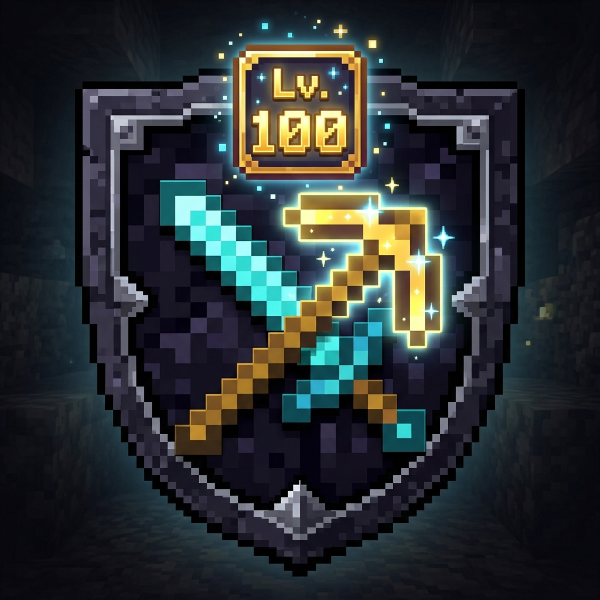

<div align="center">

# ⚔️ VanillaRPG by S4ulP
**Un ecosistema RPG nativo, modular y escalable para Minecraft Bedrock Edition (MCPE)**

[](https://minecraft.net/)
[](https://learn.microsoft.com/en-us/minecraft/creator/scriptapi/)
[](LICENSE)
[](https://github.com/SaulPvr35)

<p align="center">
  
</p>

*Convierte tu supervivencia vanilla en una experiencia RPG equilibrada, desafiante y con sentido de progresión real, sin romper la esencia original del juego.*

</div>

---

## 🌟 Características Principales

### 🎯 1. Niveles Universales en Criaturas (Lv. 1 - 100)
- **Compatibilidad Global Automática**: Todas las criaturas vivas (pasivas, hostiles, neutrales y mobs agregados por otros addons) reciben un nivel del **1 al 100**.
- **Indicador Visual en Tiempo Real**: NameTag multilínea dinámico que muestra:
  - Nivel y nombre con color según peligro (`Verde <50`, `Amarillo 50-79`, `Rojo 80+`).
  - Afijos y auras activas.
  - Barra numérica de salud (`❤ VidaActual/VidaTotal`) y factor de daño (`⚔ 1.0x - 15.0x`).
- **Física Vanilla Intacta**: Daño, empuje (knockback) y gravedad nativas sin bugs de flotación.

### 💀 2. Bosses del Mundo Especiales
- Los mobs hostiles tienen probabilidad de spawnear como **[BOSS]** con estadísticas colosales:
  - **Vida Masiva**: Escalado amplificado de salud.
  - **Teletransporte Táctico**: Si intentas dispararles de lejos o huir (>7 bloques), el Boss se teletransporta instantáneamente a tu espalda.
  - **Instakill por Desprotección**: Asesta muerte instantánea si te golpea y no llevas al menos 3 piezas de armadura equipadas.
  - **Auras Debilitantes**: Ceguera y lentitud en combates cercanos de nivel alto.
  - **Creeper Boss**: Supervelocidad y detonaciones con radio escalable de hasta **9 bloques con fuego**.

### 🗡️ 3. Progresión del Jugador
- **Nivel del Jugador (Lv. 1 - 100)**: Consigue experiencia RPG al derrotar enemigos (los Bosses otorgan x5 de XP).
- **Escalado de Daño Físico**: Cada nivel que subes aumenta tu daño en **+3%**, alcanzando **x2.5 a nivel 50** y **x4.0 a nivel 100**.

### 💎 4. Botín Arcano, Cofres y Pesca
- **Multiplicador de Drops Vanilla**: A mayor nivel, los enemigos multiplican la cantidad de sus drops naturales (huesos, pólvora, carne podrida).
- **Armas y Herramientas por Rareza**:
  - **Raro [Azul]**: `+25% Daño Físico`.
  - **Épico [Morado]**: `+60% Daño Físico`.
  - **Legendario [Dorado]**: `+150% Daño Físico` e **Irrompibilidad Absoluta (100%)**.
- **Pico Sísmico**: Los picos legendarios minan en **Área 3x3 (9 bloques)**.
- **Tesoros Naturales**: 
  - **Cofres del Mundo (40% prob)**: Generan libros con encantamientos nativos (*Filo VI/VII, Saqueo V, Fortuna IV*) y armas arcanas.
  - **Pesca con Caña (8% prob)**: Oportunidad de pescar reliquias y tesoros del fondo marino.

---

## 🏗️ Arquitectura Modular (Developer-Friendly)

El proyecto está diseñado bajo el principio de **desacoplamiento total** para que cualquier creador pueda utilizar esta base o extenderla:

```text
BP_RPG/scripts/
├── config/
│   ├── configStats.js       # Curvas de vida, daño de mobs, bosses, jugador y afijos
│   ├── configDrops.js       # Tablas de botín, drops vanilla, cofres y pesca
│   └── variablesGlobales.js # Fachada unificadora para importar
├── clases/
│   ├── EntidadRPG.js        # Lógica de cálculo de criaturas y etiquetas
│   └── ObjetoRPG.js         # Constructor de ItemStacks con encantamientos nativos
└── sistemas/
    ├── generadorNiveles.js  # Combate, absorción de daño e instakill
    ├── sistemaJugadorRPG.js # Progresión y XP del jugador
    ├── armasRPG.js          # Minería en área 3x3 e irrompibilidad
    ├── gestorLoot.js        # Multiplicación de drops en muerte
    ├── cofresYPescaRPG.js   # Inyección de botín en cofres y pesca
    └── habilidadesBoss.js   # IA de teletransporte y auras periódicas
```

---

## 📦 Instalación

1. Descarga el paquete unificado [`MiAddonRPG.mcaddon`](MiAddonRPG.mcaddon).
2. Haz doble clic en el archivo para que Minecraft Bedrock lo importe automáticamente.
3. Al crear o editar tu mundo:
   - Activa el **Behavior Pack (Paquete de comportamientos)**.
   - Activa el **Resource Pack (Paquete de recursos)**.
   - En la pestaña de experimentos, asegúrate de tener activada la opción de **Beta APIs** (Scripting API).

---

## ⚖️ Licencia y Derechos de Autor

Este proyecto está bajo la Licencia **MIT**. Eres libre de usar, modificar, bifurcar (fork) o usar esta arquitectura como base para tus propios addons, bajo la siguiente condición:

> **Requisito Obligatorio de Atribución**:  
> Si utilizas este código, paquete o arquitectura como base para tu propio proyecto o publicación en sitios como MCPEDL, CurseForge o PlanetMinecraft, **debes dar crédito explícito a [SaulPvr35 (S4ulP)](https://github.com/SaulPvr35)** y enlazar al repositorio original:  
> `https://github.com/SaulPvr35/VanillaRPG`

---

<div align="center">
  Creado con ❤️ por <b><a href="https://github.com/SaulPvr35">SaulPvr35</a></b>
</div>
